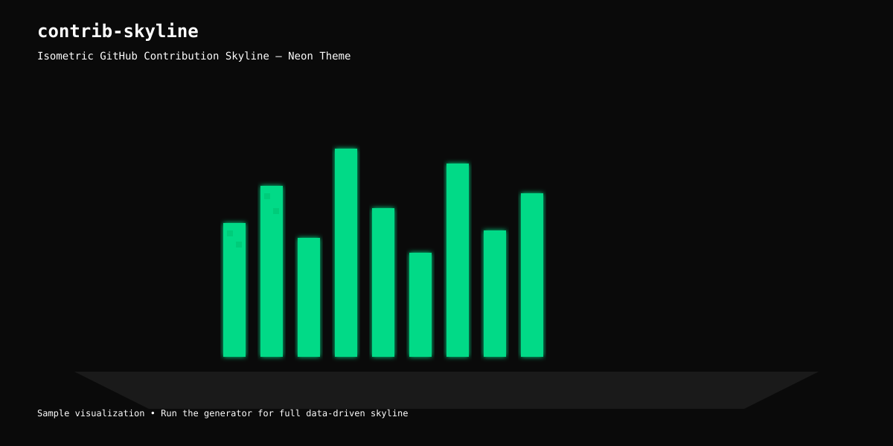
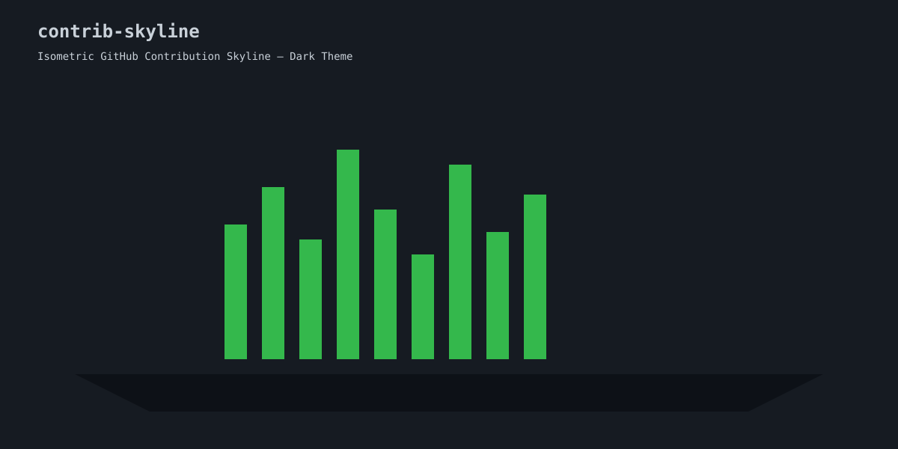
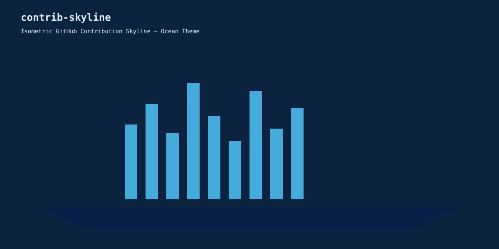

# contrib-skyline

> Turn your GitHub contribution graph into a living isometric skyline.  
> Clean SVG. Multiple themes. Zero dependencies. Ready for your profile README.

[](LICENSE)
[](https://www.python.org/)
[](https://github.com/ilyasaalmadani/contrib-skyline/stargazers)
[](CONTRIBUTING.md)

<div align="center">

### Your code. Your city. Your skyline.

[Quick Start](#quick-start) · [Themes](#themes) · [Examples](#examples) · [Roadmap](#roadmap)

</div>

---

## Why contrib-skyline?

Most contribution graphs are flat grids.  
**contrib-skyline** turns the same data into a 3D isometric city — each week becomes a building, and activity lights up the windows.

- Isometric skyline with proper depth and glow
- 6 ready-to-use themes (Neon, Dark, Ocean, Synthwave, Matrix, Sakura)
- Pure SVG output — no external services, works forever in READMEs
- **Real GitHub data** via GraphQL (falls back to sample if no token)
- Stats overlay (total contributions, active days, longest streak)
- GitHub Action ready for daily auto-generation

## Examples

<div align="center">

### Neon


### Dark


### Ocean


</div>

> Run `python3 src/generate_skyline.py` to generate all 6 themes (including Synthwave, Matrix, Sakura) into the `examples/` folder.

## Quick Start

```bash
git clone https://github.com/ilyasaalmadani/contrib-skyline.git
cd contrib-skyline
python3 src/generate_skyline.py
```

This generates all themes into the `examples/` folder using sample data.

### Use your real contribution data

```bash
export GITHUB_USERNAME=yourname
export GITHUB_TOKEN=ghp_xxxxxxxx   # needs read:user or public_repo scope
python3 src/generate_skyline.py
```

### Embed in your profile README

```markdown

```

Or generate your own and host it in your profile repository.

## Themes

| Theme       | Style              | Best for          |
|-------------|---------------|-------------------|
| neon        | Cyberpunk green    | Dark profiles     |
| dark        | GitHub-native      | Classic look      |
| ocean       | Cool blues         | Calm aesthetic    |
| synthwave   | Pink / purple      | Retro-futuristic  |
| matrix      | Green on black     | Terminal vibe     |
| sakura      | Soft pink          | Soft / elegant    |

## Features

| Feature              | Status | Notes                                      |
|----------------------|--------|--------------------------------------------|
| Isometric Skyline    | ✅     | Week-based buildings with window lighting  |
| 6 Themes             | ✅     | Easy to extend                             |
| Pure SVG             | ✅     | Lightweight and GitHub-friendly            |
| Sample Generator     | ✅     | Realistic activity simulation              |
| Stats Overlay        | ✅     | Total, active days, longest streak         |
| Real GitHub Data     | ✅     | GraphQL + automatic sample fallback        |
| GitHub Action        | ✅     | Daily generation + auto-commit ready       |
| Custom Themes        | 🚧     | Easy to add (edit THEMES dict)             |

## Roadmap

- [x] Fetch real contribution data via GitHub GraphQL
- [x] GitHub Action that regenerates SVGs daily
- [ ] Interactive web preview / theme builder
- [ ] Multi-year comparison view
- [ ] Animation support (CSS / SMIL)
- [ ] CLI flags (`--username`, `--theme`, `--year`)

## Contributing

Contributions are welcome. See [CONTRIBUTING.md](CONTRIBUTING.md).

1. Fork the repository
2. Create a feature branch
3. Add a theme or improvement
4. Open a pull request

## License

MIT © [Ilyas Akbar Almadani](https://github.com/ilyasaalmadani)

---

<div align="center">

**Built for developers who want their contribution graph to look as good as the code behind it.**

⭐ Star the repo if you like the skyline — it helps it grow.

</div>
